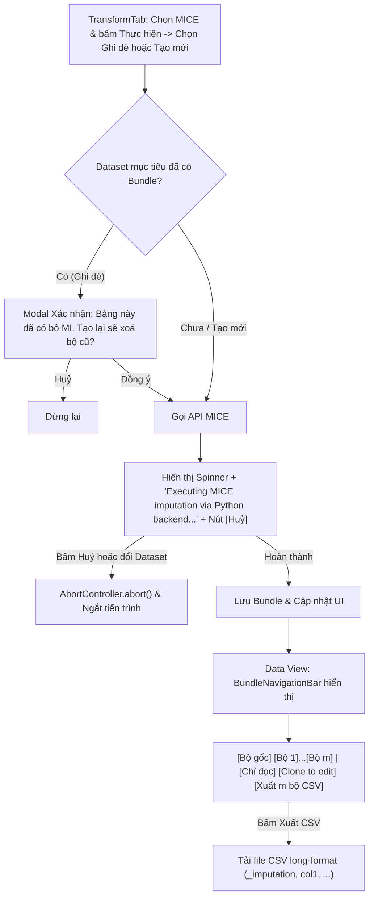

# Kế Hoạch Mang Các Cải Tiến UI/UX & Edge Cases Từ Nhánh Cũ Sang Nhánh Mới (Cập nhật lần 2)

> **Mục tiêu:** Kế thừa các cải tiến thiết thực về trải nghiệm người dùng (UI/UX), xử lý biên (edge cases), hộp thoại xác nhận an toàn, cơ chế huỷ tác vụ và tiện ích xuất dữ liệu từ nhánh cũ (`feature/issue-8-mice-multiple-imputation`) sang nhánh mới (`feature/issue-8-mice-multiple-imputation-NEW`), **giữ nguyên 100% backend, cấu trúc Sparse Delta, và tuân thủ các luồng giao diện của nhánh mới**.

---

## 1. Các điểm thống nhất theo yêu cầu

1. **Giữ nguyên luồng nút MICE của bản mới:** Nút "Thực hiện" và modal "Ghi đè bảng gốc / Tạo dataset mới" giữ nguyên như hiện tại.
2. **Giữ nguyên chế độ Chỉ đọc (Read-only):** Sử dụng badge `Lock` và nút `Nhân bản để sửa (Clone to edit)` trên `BundleNavigationBar`, không thêm toast khi click ô.
3. **Tab Phân tích (RegressionTab):** Không thêm bảng $m$ lần điền riêng lẻ, không thêm khối giải thích FMI/df.
4. **Bảng Báo cáo MICE:** Bỏ dòng ghi chú chân bảng báo cáo theo góp ý.
5. **Thông báo khi đang chạy MICE:** Giữ nguyên chuỗi hiện tại `Executing MICE imputation via Python backend...` (`transformTab.mice.loading`) kèm spinner, bổ sung nút **"Huỷ"** bên cạnh.
6. **Vị trí Nút "Xuất m bộ (CSV)":** Đặt tại **View Data subtab** (trong `BundleNavigationBar`), nằm ngay **cạnh nút "Clone to edit"**.

---

## 2. Sơ đồ luồng trải nghiệm (Flowchart)



---

## 3. Chi tiết các hạng mục triển khai

### 3.1. TransformTab (`src/features/data/TransformTab.tsx`)

#### [MODIFY] `src/features/data/TransformTab.tsx`

1. **Cơ chế Huỷ khi đang chạy MICE (`AbortController` + Nút "Huỷ"):**
   - Thêm `abortControllerRef = useRef<AbortController | null>(null)`.
   - Cleanup khi unmount hoặc đổi dataset: `abortControllerRef.current?.abort()`.
   - Truyền `abortCtrl.signal` vào `analyzeMiceImputation(...)`.
   - Hiển thị thanh tiến trình: giữ nguyên câu thông báo `t("transformTab.mice.loading")` (`Executing MICE imputation via Python backend...`) và bổ sung nút **Huỷ**:
     ```tsx
     {isMiceLoading && (
       <div role="status" className="flex flex-wrap items-center gap-3 mb-3 text-sm text-sky-600 dark:text-sky-400">
         <Loader2 className="w-4 h-4 animate-spin shrink-0" />
         <span>{t("transformTab.mice.loading")}</span>
         <button
           type="button"
           onClick={() => abortControllerRef.current?.abort()}
           className="rounded-md border border-sky-300 px-2 py-0.5 text-xs font-medium hover:bg-sky-100 dark:border-sky-700 dark:hover:bg-sky-900 transition"
         >
           {t("transformTab.cancelButton")}
         </button>
       </div>
     )}
     ```

2. **Hộp thoại xác nhận khi tạo lại MICE trên dataset đã có Bundle:**
   - Khi người dùng chạy MICE và chọn ghi đè lên bảng đã có `imputationMeta`:
     Hiển thị modal xác nhận trước khi gọi backend:
     - **Tiêu đề:** *"Bảng này đã có bộ MI"* (`t("transformTab.mice.replaceConfirmTitle")`)
     - **Nội dung:** *"Tạo lại sẽ xoá bộ MI hiện có. Bạn có muốn tiếp tục?"* (`t("transformTab.mice.replaceConfirmBody")`)
     - **Nút:** `[Huỷ]` và `[Thay bộ MI]`.

3. **Cảnh báo khi chạy các Transform khác (Filter, Sort, Drop Missing...) ghi đè lên Dataset có Bundle:**
   - Khi người dùng thực hiện phép Transform khác và chọn *"Ghi đè bảng gốc"* trên dataset đang có `imputationMeta`:
     Hiển thị cảnh báo: *"Bảng này có {m} bộ đã điền. Ghi đè dữ liệu sẽ xoá các bộ đó. Tiếp tục?"*.
     Nếu xác nhận: xoá `imputationMeta`, gỡ cờ `readOnly`, và áp dụng dữ liệu mới (bảo vệ tính toàn vẹn `rowIndex` của Sparse Delta).

4. **Xử lý các Edge Cases trước khi chạy:**
   - **Không có ô khuyết (`noMissing`):** Nếu các cột được chọn không có ô missing nào, hiển thị toast thông báo: *"Các biến đã chọn không có ô khuyết nên không có gì để điền."* và dừng lại, không gọi API.
   - **Chưa nạp đủ dữ liệu (`needFullData`):** Nếu bảng chỉ có dữ liệu xem trước (`preview`), cảnh báo: *"Cần nạp đủ dữ liệu cho bảng này trước khi tạo bộ MI."* và vô hiệu hoá nút.

---

### 3.2. Data View & Thanh Điều Hướng Bundle (`src/features/data/grid/BundleNavigationBar.tsx`)

#### [MODIFY] `src/features/data/grid/BundleNavigationBar.tsx`

1. **Thêm Nút "Xuất {m} bộ (CSV)" cạnh nút "Clone to edit":**
   - Đặt ngay sau nút `bundle-clone-btn`:
     ```tsx
     <button
       type="button"
       data-testid="bundle-export-csv-btn"
       onClick={handleExportCsv}
       className="inline-flex items-center gap-1.5 px-2.5 py-1 text-xs font-medium rounded-md border border-neutral-300 dark:border-neutral-600 bg-white dark:bg-neutral-800 hover:bg-neutral-50 dark:hover:bg-neutral-700 text-neutral-700 dark:text-neutral-200 shadow-2xs transition"
       title={t("dataGrid.bundleExportCsvBtn", { m })}
     >
       <Download className="w-3.5 h-3.5" />
       <span>{t("dataGrid.bundleExportCsvBtn", { m })}</span>
     </button>
     ```
2. **Logic xuất file CSV chuẩn Đa nhập liệu (`long-format`):**
   - Tái tạo $m$ bộ dữ liệu hoàn chỉnh từ `originalRows` và `sparsePatches`.
   - Header: `_imputation, <col1>, <col2>, ...`
   - Dữ liệu: Với mỗi $k \in [1..m]$, xuất các dòng dữ liệu của bộ $k$ với cột đầu là $k$ (tổng cộng $m \times n$ dòng).
   - Tải file dạng UTF-8 BOM CSV: `<dataset_name>_MI_m{m}.csv`.

---

### 3.3. AppSidebar (`src/components/layouts/AppSidebar.tsx`)

#### [MODIFY] `src/components/layouts/AppSidebar.tsx`

- **Badge nhận diện Bundle trực quan trên Sidebar:**
  - Hiển thị badge nhỏ gọn bên cạnh tên dataset khi `d.imputationMeta` tồn tại:
    ```tsx
    {d.imputationMeta && (
      <span className="rounded-full border border-sky-300 px-1.5 py-0.5 text-[10px] font-medium text-sky-700 dark:border-sky-700 dark:text-sky-300">
        MI · {d.imputationMeta.m} bộ
      </span>
    )}
    ```

---

### 3.4. Từ điển Quốc tế hóa (`src/i18n.ts`)

#### [MODIFY] `src/i18n.ts`

- Đảm bảo đầy đủ bản dịch tiếng Anh và tiếng Việt:
  - `transformTab.mice.loading`: "Executing MICE imputation via Python backend..." / "Đang thực thi nội suy MICE qua Python backend..."
  - `transformTab.mice.replaceConfirmTitle`: "This table already has an MI set" / "Bảng này đã có bộ MI"
  - `transformTab.mice.replaceConfirmBody`: "Creating it again will delete the current MI set." / "Tạo lại sẽ xoá bộ MI hiện có."
  - `transformTab.mice.replaceConfirmOk`: "Replace MI set" / "Thay bộ MI"
  - `transformTab.mice.noMissing`: "The selected variables have no missing cells, so there is nothing to impute." / "Các biến đã chọn không có ô khuyết nên không có gì để điền."
  - `transformTab.mice.needFullData`: "Load the full data for this dataset before creating MI sets." / "Cần nạp đủ dữ liệu cho bảng này trước khi tạo bộ MI."
  - `dataGrid.bundleExportCsvBtn`: "Export {m} sets (CSV)" / "Xuất {m} bộ (CSV)"
  - `mi.invalidateTitle`: "Editing will delete the MI set" / "Sửa dữ liệu sẽ xoá bộ MI"
  - `mi.invalidateBody`: "This table has {m} imputation sets. Overwriting data will delete them. Continue?" / "Bảng này có {m} bộ đã điền. Ghi đè dữ liệu sẽ xoá các bộ đó. Tiếp tục?"

---

## 4. Kế hoạch Kiểm thử & Xác minh

### 4.1. Automated Tests
Chạy kiểm thử Vitest trong worktree:
```bash
npm --prefix "c:\Users\Ku Bach\Desktop\khoa-luan\Quantis\.worktrees\issue-8" test -- src/features/data/__tests__/transformTabMice.test.tsx
npm --prefix "c:\Users\Ku Bach\Desktop\khoa-luan\Quantis\.worktrees\issue-8" test -- src/features/data/grid/__tests__/bundleDataGrid.test.tsx
```
Bổ sung test cases mới:
1. Nhấn nút "Huỷ" khi spinner đang chạy -> ngắt tiến trình qua `abort()`.
2. Chạy MICE ghi đè lên bảng đã có `imputationMeta` -> bật hộp thoại xác nhận `replaceConfirm`.
3. Bấm nút "Xuất {m} bộ (CSV)" trên `BundleNavigationBar` -> tải về file CSV với cột `_imputation` và $m \times n$ dòng.
4. Cột không có ô khuyết -> hiển thị toast `noMissing` và ngắt sớm.

### 4.2. Manual Verification
1. Chọn MICE, bấm Thực hiện -> kiểm tra spinner kèm thông báo `Executing MICE imputation via Python backend...` và nút "Huỷ".
2. Chuyển sang View Data tab -> kiểm tra thanh `BundleNavigationBar` có nút `Xuất {m} bộ (CSV)` cạnh nút `Clone to edit`. Bấm xuất và mở file kiểm tra.
3. Kiểm tra Sidebar có badge `MI · {m} bộ`.
4. Chạy lại MICE và chọn ghi đè -> kiểm tra hộp thoại cảnh báo "Bảng này đã có bộ MI. Tạo lại sẽ xoá bộ cũ." xuất hiện.
5. Chạy transform khác (như Filter) ghi đè lên bảng có Bundle -> kiểm tra hộp thoại xác nhận xoá bộ MI xuất hiện.
